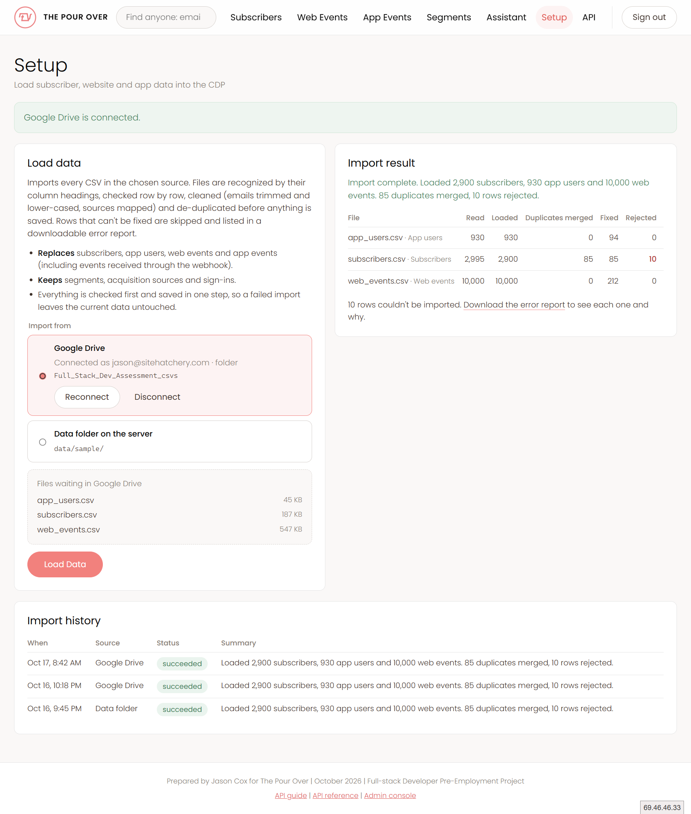
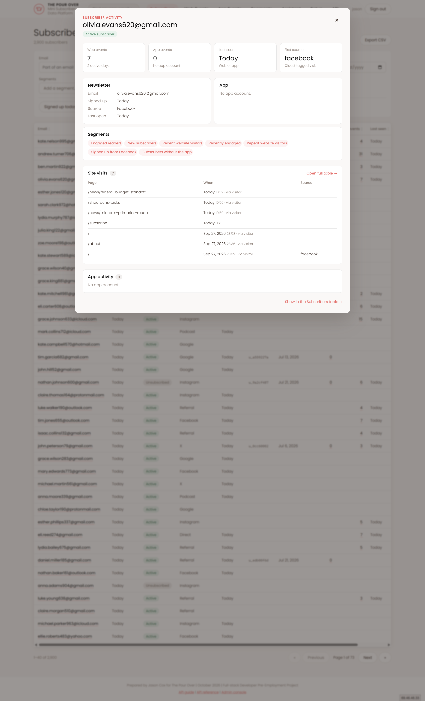
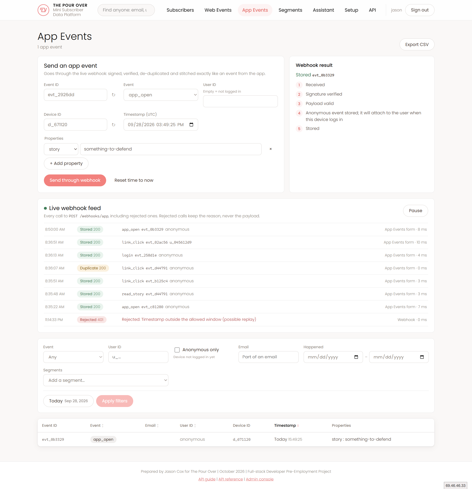
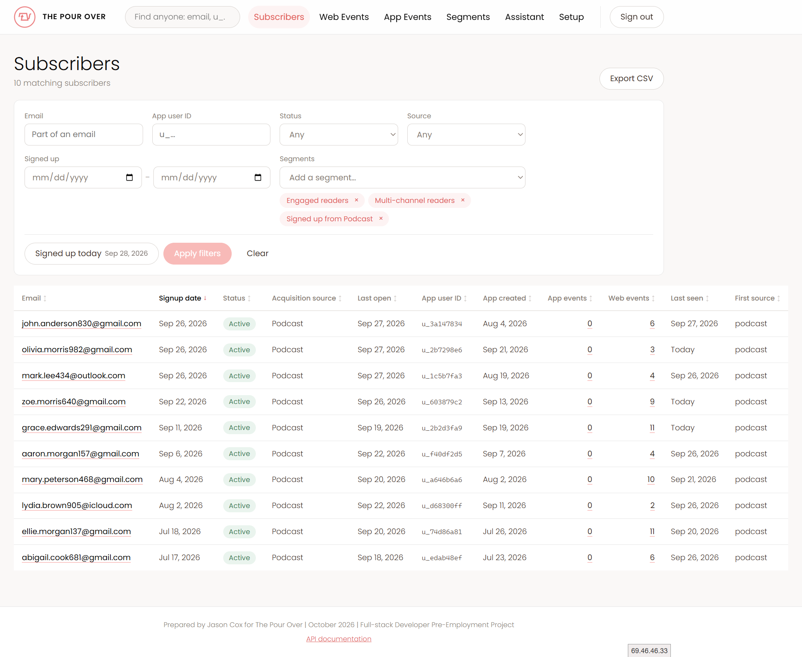
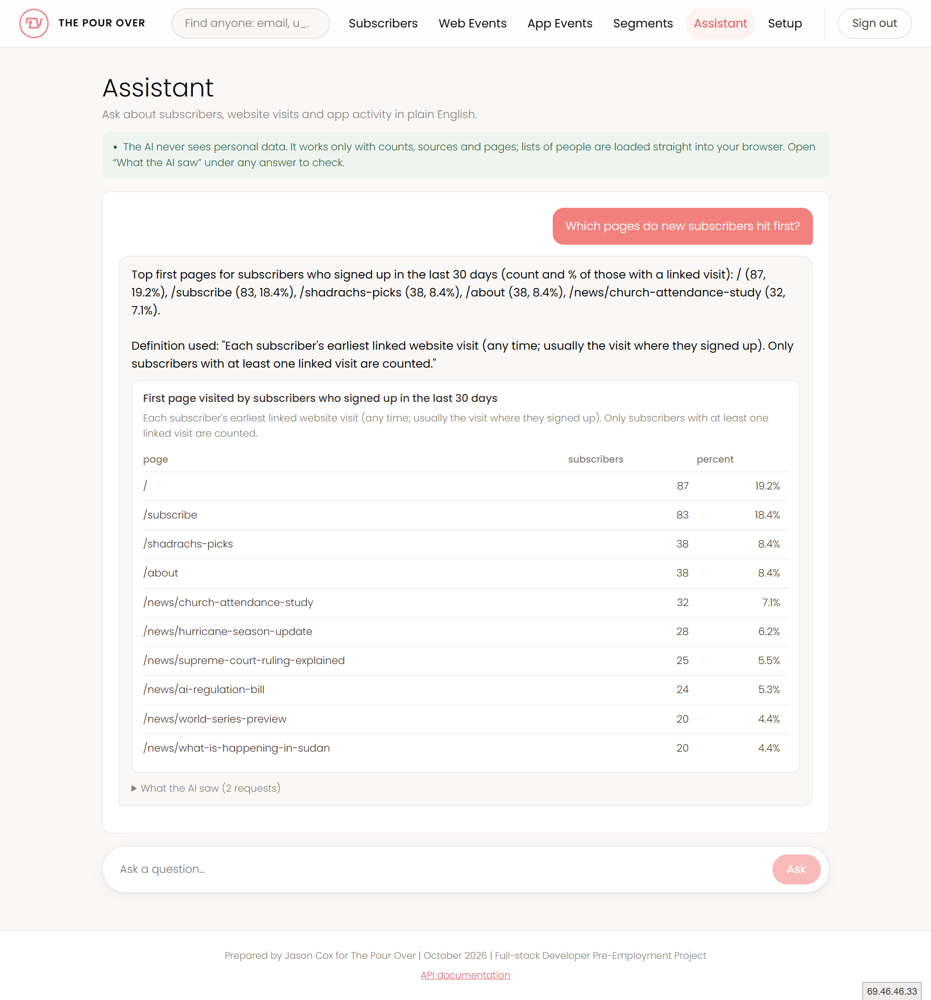
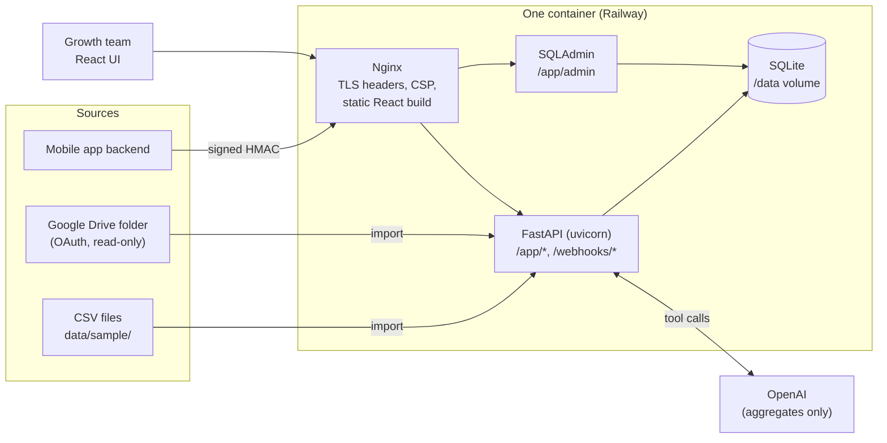

# The Pour Over: Mini CDP

A small customer data platform that brings newsletter subscribers, website visits and app activity into one place for the Growth team. Built as a take-home assessment for The Pour Over.

- **Live:** https://thepourover.seedcast.ai (sign-in required; also at https://cdp-production-102e.up.railway.app)
- **Webhook:** `POST https://thepourover.seedcast.ai/webhooks/app` (alias of `/app/webhooks/app`), signed as described below
- **API guide:** https://thepourover.seedcast.ai/api (in the app), with the interactive reference at [`/app/docs`](https://thepourover.seedcast.ai/app/docs)
- **Admin console:** https://thepourover.seedcast.ai/app/admin/ (admin users only)

## What it does

| Brief requirement | Where |
|---|---|
| Load, link and de-duplicate the three CSVs | **Setup** page → Load Data (from the server's data folder or a Google Drive folder); `python -m app.cli import` |
| Subscriber lookup | Search box in the header (any part of an email or an id) → profile with web and app activity; **Subscribers** list with filters |
| Segment builder | **Segments**: 22 built-in segments plus a rule builder with a live member count |
| `POST /webhooks/app` | Signed webhook; duplicates, out-of-order events, anonymous-then-login stitching and unknown users all handled. **App Events** has a form that sends through the real webhook and a live feed of every call |
| AI assistant without PII | **Assistant**: plain-English questions answered with tools that return aggregates only, plus a "What the AI saw" panel |

### Screenshots

The data shown is the assessment's sample data.

| | |
|---|---|
|  |  |
| **Setup:** a Google Drive import, with per-file counts and the import history | **Lookup:** one person's newsletter, web and app activity, and their segments |
|  |  |
| **Webhook:** an event sent through the real webhook with each step, and the live feed of every call: stored, duplicate and rejected | **Segments as filters:** seven segments combined, narrowing 2,900 subscribers to 10 |
|  | |
| **Assistant:** an answer with the definition it used and a table; "What the AI saw" shows the exact requests | |

Beyond the brief: Google Drive import, token and API-key auth, CSV export on every list, the in-app API guide, an admin console, the live webhook feed, request logging without personal data, and tests with CI.

## Architecture



- **Back end:** Python 3.12, FastAPI, SQLAlchemy 2 (one set of models for the API, migrations and admin), Alembic, SQLite with WAL.
- **Front end:** React 19 + TypeScript, built with Vite. List state (filters, sort, page) lives in the URL, so views can be bookmarked and shared.
- **Flow:** an import validates every row, de-duplicates and links, then replaces the CSV data in one transaction. App events from the webhook are kept across imports. The API reads SQLite directly; segments are evaluated live, so a webhook event can change a segment straight away. Nothing is cached or precomputed.
- **Production:** one Docker image. A Node stage builds the React app; the runtime runs uvicorn behind Nginx under `tini`. Nginx serves the build, proxies `/app` and `/webhooks`, and sets HSTS, CSP and the other security headers.

```
backend/app/
  rules.py          the shared data rules (email normalization, dates, "today")
  importer/         sources (folder, Drive) → prepare (validate, dedupe, link) → load
  webhook/          signing, event handling and stitching, the call log
  segments/         field catalog, definition → SQL compiler, built-in segments
  assistant/        OpenAI tool loop, aggregate-only tools, PII guard
  routers/          HTTP endpoints        admin.py   SQLAdmin views
  auth/             passwords, tokens, API keys    observability.py   logging and errors
frontend/src/       pages, components, api client, tests (*.test.tsx)
deploy/             Nginx config, start script, local Apache vhost
```

## Run it locally

Prerequisites: Python 3.12 and Node 22.

```bash
# Back end
cd backend
py -3.12 -m venv .venv
.venv\Scripts\pip install -r requirements.txt
copy .env.example .env                           # then fill in CDP_JWT_SECRET and CDP_WEBHOOK_SECRETS
.venv\Scripts\python -m app.cli init-db          # migrations + reference data + built-in segments
.venv\Scripts\python -m app.cli import           # load data/sample/*.csv
.venv\Scripts\python -m app.cli create-user growth --admin  # UI and admin login (prompts for a password)
.venv\Scripts\python -m app.cli create-api-key local-dev    # API key for scripts; printed once
.venv\Scripts\python -m uvicorn app.main:app --port 8000

# Front end (second terminal)
cd frontend
npm install        # in PowerShell, use npm.cmd if script execution is disabled
npm run dev        # http://localhost:5173, proxies /app and /webhooks to the API
```

Settings come from environment variables or `backend/.env`. [`backend/.env.example`](backend/.env.example) lists every setting with its default and no real secrets. "Today" is fixed at **2026-09-28**, per the brief. For `https://cdp.local` through WAMP, see `deploy/apache/cdp.local.conf`.

### Try the API in Postman

Import [`docs/postman/mini-cdp.postman_collection.json`](docs/postman/mini-cdp.postman_collection.json). It has 27 requests: sign-in, subscribers and profiles, events, segments, the assistant, and the webhook.

1. Create a Postman environment with `username`, `password` and `webhookSecret` (mark the last two as secret). `baseUrl` defaults to the live site; set it to `http://127.0.0.1:8000` to use a local copy.
2. Run **1. Sign-in → Sign in**. It saves the access and refresh tokens, and every other request uses them. To use an API key instead, paste it into the `bearerToken` variable. Keys are created, rotated and revoked in the admin console, not through the API.
3. Run **4. Webhook** in order: an anonymous event, a login that attaches it, the same event again (duplicate), a bad signature (401), an earlier event that arrives late and still attaches (out of order), and a login from a user id never seen before (placeholder profile). Each request signs itself with HMAC-SHA256 in a pre-request script, the same way the mobile app's backend would.

## Tests

```bash
cd backend && .venv\Scripts\python -m pytest     # 141 tests
cd frontend && npm test                          # 19 tests (Vitest + React Testing Library)
```

- **Back end:** import counts checked against hand-written SQL, every dedupe and linking rule, the webhook (signatures, replay, duplicates, every stitching order, placeholders, the call log), segments (every operator, the brief's example), auth (token rotation and reuse detection, API key rotation), the admin console, PII-free logging, and the assistant (the brief's three questions against a scripted model, checking that no email or id from the database is ever sent).
- **Front end:** filter bar state, table sorting and pagination, App Events form validation, the live webhook feed and the segment builder.
- **CI:** `.github/workflows/ci.yml` runs both suites, lint, the type check and the build on every push and pull request.

## Data rules

### Email normalization

One rule, in [`backend/app/rules.py`](backend/app/rules.py): trim and lowercase (`_canonical`). `normalize_email()` applies it to whole addresses and rejects anything that isn't one; `normalize_search()` applies it to partial search terms.

- `normalize_email()` is called by the importer for all three files (`importer/prepare.py`) and by the admin console when an email is typed in (`admin.py`). Nothing else writes an email.
- `normalize_search()` is called by profile search and every email filter (`routers/subscribers.py`, `routers/events.py`), so `" GMAIL.com"` finds `gmail.com` addresses.
- The webhook carries no email: app events reach a person through `user_id`.

### Subscriber de-duplication

Rows are grouped by normalized email. The kept row is the one with the latest `last_open_date`, then the latest `signup_date`, then the later row in the file. Blank fields on the kept row are filled from the others. Status is the exception: if any row for an email says `unsubscribed`, the subscriber stays unsubscribed, because an opt-out must never be undone by a more recent duplicate. In the sample, all 85 duplicates differ only by email case or whitespace, and none disagree on status.

### Linking

- **App users → subscribers:** by normalized email. 900 of 930 link.
- **Web events → people:** by the event's own email when it has one. Events without an email take the email of the same `visitor_id`'s identified events (backfill), unless that visitor used more than one email, in which case they're left anonymous rather than guessed. 8,441 of 10,000 web events are attributed (7,041 through backfill).
- **App events → people:** through `user_id` to the app user, then to the subscriber.
- **Sources:** `utm_source` and acquisition sources are matched through an alias table, so `twitter` and `X` are the same source.

### Rejected rows

Blank rows, invalid emails and unreadable required dates are skipped and listed in a downloadable error report (row number, column, reason). Good rows still load. Fixable values (case, whitespace, alias spellings) are fixed and counted.

### Importing again

Subscribers and web events exist only in the CSVs, so each import replaces them. App events exist only because the webhook delivered them, so imports never touch them. App users are merged: a user in the file is added or updated in place (which completes a webhook placeholder), and a user missing from the file is deleted only if it has no app events; otherwise it stays as a placeholder. Everything is then relinked by email. Editing an email in the admin console relinks the same way.

| File | Read | Loaded | Fixed | Rejected | Duplicates merged |
|---|---|---|---|---|---|
| subscribers.csv | 2,995 | 2,900 | 85 | 10 | 85 |
| app_users.csv | 930 | 930 | 94 | 0 | 0 |
| web_events.csv | 10,000 | 10,000 | 212 | 0 | 0 |

### Edge cases these rules miss

- **One person, two emails** (e.g. work and personal) stays two people. Nothing in the data links them reliably.
- **A shared device** (two people on one phone without logging out in between): anonymous events go to whoever logs in next.
- **A `visitor_id` reset** (cleared cookies, new browser) starts a new anonymous visitor; their earlier visits only join up if they identified themselves on both.
- **A reinstalled app** gets a new `device_id`, so anonymous events from before the reinstall never attach.
- **Typos in emails** (`gmial.com`) are valid addresses and aren't corrected.
- **Merging two subscribers** through the admin console isn't supported; a corrected email that collides with another subscriber is refused.
- **Column lengths** (64 characters for emails, 24 for source names) aren't enforced by SQLite. On Postgres, longer values would be rejected, and source names sharing their first 24 characters would collide.

## App events webhook

`POST /webhooks/app` (the brief's path) and `POST /app/webhooks/app` run the same handler.

```json
{"event_id": "evt_9f3a1c", "event": "read_story", "user_id": "u_2b6447a3", "device_id": "d_4b21e8",
 "timestamp": "2026-09-28T14:22:05Z", "properties": {"story": "supreme-court-ruling-explained"}}
```

Requests are signed like Stripe's: HMAC-SHA256 over `{timestamp}.{raw body}` with the shared secret, sent as `X-CDP-Timestamp` (Unix seconds) and `X-CDP-Signature: sha256=<hex>`. Requests more than 5 minutes old are refused (replay protection), comparison is constant-time, several secrets can be active at once for rotation (`CDP_WEBHOOK_SECRETS`), and the endpoint is rate limited.

```bash
BODY='{"event_id":"evt_1001","event":"login","user_id":"u_2b6447a3","device_id":"d_42","timestamp":"2026-09-28T14:05:00Z","properties":{}}'
TS=$(date +%s)
SIG=$(printf '%s.%s' "$TS" "$BODY" | openssl dgst -sha256 -hmac "$CDP_WEBHOOK_SECRET" -hex | sed 's/^.* //')
curl -X POST https://thepourover.seedcast.ai/webhooks/app -H "Content-Type: application/json" \
  -H "X-CDP-Timestamp: $TS" -H "X-CDP-Signature: sha256=$SIG" --data-raw "$BODY"
```

```python
import hashlib, hmac, json, os, time, urllib.request
body = json.dumps({"event_id": "evt_1001", "event": "login", "user_id": "u_2b6447a3", "device_id": "d_42",
                   "timestamp": "2026-09-28T14:05:00Z", "properties": {}}).encode()
ts = str(int(time.time()))
sig = hmac.new(os.environ["CDP_WEBHOOK_SECRET"].encode(), ts.encode() + b"." + body, hashlib.sha256).hexdigest()
urllib.request.urlopen(urllib.request.Request("https://thepourover.seedcast.ai/webhooks/app", data=body, headers={
    "Content-Type": "application/json", "X-CDP-Timestamp": ts, "X-CDP-Signature": f"sha256={sig}"}))
```

The in-app API guide has the same example in Node.

How events are handled:

- **Duplicates:** `event_id` is the primary key. A repeat returns 200 with `"status": "duplicate"` and changes nothing, so senders can retry safely. A repeated `event_id` with a *different* body is also treated as a duplicate: the first version wins.
- **Out of order:** events are stored with their own timestamp (plus `received_at`), and every read sorts by event time.
- **Login stitching:** an anonymous event belongs to the *next* identified event from the same device. When an event with a `user_id` arrives, the device's anonymous events since its previous identified event are attached to that user. An anonymous event that arrives late takes the user of the device's next identified event. An anonymous event *after* a login stays anonymous: the brief says `user_id` is present on every event after login, so a null means the device logged out.
- **Unknown `user_id`:** never dropped. A placeholder app user is created so the person shows up in lookup and segments, and a later import that includes the user completes it. Two first events for the same new user arriving at once are handled (a database savepoint), not a 500.
- **No restart needed:** events are written straight to the database every page and segment reads.
- **Visibility:** the response lists each processing step. Every call, including rejected ones, is logged and shown in the live feed on the App Events page. Rejected calls keep only the reason, never the payload.
- **Testing from the app:** signed-in users can send events from the App Events page, which signs them on the server. That's deliberate for demos; in production it would be limited to a test role.

Stitching limits: timestamps come from the sender and are trusted (naive ones are read as UTC). Two events with the same timestamp on one device are ordered arbitrarily. Once an anonymous event is attached to a user it isn't flagged as stitched, so a late identified event for a *different* user on that device won't reclaim it.

## Segments

A segment is a saved definition, evaluated live against the database every time it's used.

```json
{"match": "all", "filters": [
  {"field": "acquisition_source", "operator": "equals", "value": "Instagram"},
  {"field": "last_open_date", "operator": "not_within_last_days", "value": 30}
]}
```

- **People:** segments select people: every subscriber (`s_<id>`), plus app users who never subscribed (`u_<id>`, including webhook placeholders). Each person has computed fields: app account, app and web activity counts, active days, first web source, last seen.
- **Schema:** `GET /app/segments/schema` lists every field, its operators and its allowed values. The builder, the AI assistant and the API guide all use it, and it has no email or other personal field.
- **Safety:** definitions are validated against the schema, field names map to an allow-list, and every value is a bound SQL parameter.
- **Relative dates** count back from the configured today. "Not within the last N days" includes people with no date at all (e.g. never opened).
- **Built-in catalog:** 22 segments, including the brief's "Instagram signups not opened in 30 days" (229 people in the sample). Seeding only adds missing segments, so edits are kept.

## AI assistant and PII

The Assistant page answers plain-English questions ("How many Instagram signups went cold last month?", "Build me a list of our most engaged readers", "Which pages do new subscribers hit first?") with an answer, a table or a new segment. It uses OpenAI with tool calling (`gpt-5-mini` by default).

**The model never sees personal data.** What crosses the boundary: the question (redacted), the segment field schema, and tool results that are counts, percentages, sources, pages, event types and segment rules. It's enforced in layers:

1. **Tools return aggregates only** (`assistant/tools.py`). The model can't query the database or read rows.
2. **Lists stay in the browser.** `list_people` gives the model a result id and a count. The browser fetches the actual people from `GET /app/assistant/results/{id}`, behind login, and that response never goes back to the model.
3. **The question is redacted** before sending: emails and ids (`u_…`, `v_…`, `d_…`, `evt_…`, `s_…`) are removed.
4. **A guard checks every outbound payload** (`assistant/pii.py`). If anything looks like an email or one of our ids, the request is blocked, and a tool result like that is withheld. A bug in layer 1 fails closed instead of leaking.
5. **The model's output is checked too.** Tool arguments it writes are rejected before anything runs if they look like an email or an id, and its messages are redacted before they're stored, echoed back or shown.
6. **Transparency:** every answer has a "What the AI saw" panel with the exact messages sent and every tool result.

**What the guard can't catch:** it matches patterns, so it can't recognize a name, or an email typed in disguise ("jane at gmail dot com") in the question. The data has no name fields, but the schema does pass along category values taken from the CSVs (source names and page paths); free text in those columns would reach the model unless it looks like an email or an id.

Definitions the assistant uses (each report carries its definition, and the model is told to quote it rather than invent one): "went cold" = active, no open in 30 days (including never), signed up more than 30 days ago. "Engaged" = the Engaged readers segment (opened within 14 days and seen within 30). "Last month" = the calendar month before the configured today (August 2026).

## Security

- **Sign-in:** UI users get a 15-minute JWT access token, kept in memory, and a single-use refresh token in an httpOnly, SameSite=Strict cookie scoped to `/app/auth`. Reusing an old refresh token revokes the whole chain. Passwords are hashed with Argon2id; unknown usernames take as long as wrong passwords; login is rate limited.
- **API keys** (`cdp_…`) for other systems are stored as SHA-256 hashes, shown once, and can be rotated (24-hour overlap) or revoked from the admin console or the CLI.
- **Admin console:** admins only, with its own SameSite=Strict, Secure cookie scoped to `/app/admin` and an 8-hour limit. Admin status is re-checked on every request, and changes are audit-logged without field values. Its session key is derived from `CDP_JWT_SECRET`; if that were ever missing, a random per-process key is used instead, so a session can't be forged.
- **Webhook:** HMAC signatures with replay protection, secret rotation, a 16 KB body limit, strict payload validation (unknown fields and bad ids are rejected) and rate limiting.
- **Secrets** come from environment variables only. `.env` is git-ignored. Production secrets were generated and set on Railway without being printed. Google tokens are encrypted at rest.
- **Headers:** HSTS, a strict CSP per area (the API answers with `default-src 'none'`), `X-Frame-Options: DENY`, `nosniff`, a referrer policy and a permissions policy.
- **Client addresses:** only Nginx is trusted to forward them, and the address is read from the end of `X-Forwarded-For` that the platform's proxy writes, so a caller can't choose an address to dodge the rate limits.
- **Logs:** one line per request with the route template, status, timing and request id. Query strings and raw paths are never logged, since searches carry emails; Nginx logs `$uri` only. Unhandled errors log stack frames without the exception message (SQL errors quote parameters).
- **CSV exports** escape cells that start with `=`, `+`, `-` or `@` (formula injection).

**Known limitations:** there are no roles: every signed-in user and every API key can read and export all personal data, run an import, and manage Drive and segments (admin-only is limited to the admin console). Assistant result sets are held in memory and readable by any signed-in user with the id. Rate limits are in memory (fine for one process; several would need Redis). SQLite means one writer, which suits this size. There's no CSP nonce: the admin pages need `'unsafe-inline'`. Nginx's *error* log can still quote a request line when the upstream fails.

**Next security improvement:** roles. Most of the Growth team would work with segments and counts, and only a few people could see or export emails, with every export logged. API keys would get scopes (read-only, webhook-only), admins would need multi-factor sign-in, and the rate limits would move to a shared store so they hold across instances.

## Design decisions beyond the brief

- **Google Drive import.** Files from other systems usually arrive in a shared folder, not on the server. OAuth (code flow + PKCE), read-only scope, encrypted refresh token; Sheets are exported as CSV.
- **Everything under `/app`.** The API, webhook, docs and admin share one prefix, so one proxy rule serves the API and the rest is the React app. The brief's `/webhooks/app` is kept as an alias.
- **Real authentication** instead of a shared password: short-lived tokens with rotation, plus API keys for systems. A CDP holds personal data, so even a demo should be locked properly.
- **SQLAdmin** instead of Django for the admin: it reuses the same SQLAlchemy models instead of defining every table twice.
- **Live segments** instead of materialized membership: always current, and at this data size a count takes around 100 ms.
- **Considered but not built:** processing many large files in parallel. Files are fetched in batches (`CDP_IMPORT_BATCH_SIZE`, default 10) but validated and loaded one after another in a single transaction, which is simpler and fast enough here (4.8 s from Drive). Also not built: a queue in front of the webhook, and segment snapshots for history.

## Deployment (Railway)

One container (`Dockerfile`). The SQLite database and import reports live on a volume at `/data`. `deploy/start.sh` runs migrations, creates the first admin from `CDP_INITIAL_USER` / `CDP_INITIAL_PASSWORD`, loads the sample data the first time, then supervises uvicorn and Nginx (if either exits, the container exits and Railway restarts it). `railway.json` sets the Dockerfile build and the `/app/health` health check. Pushing `feature/foundation` deploys.

Service variables: `CDP_JWT_SECRET`, `CDP_WEBHOOK_SECRETS`, `CDP_INITIAL_USER`, `CDP_INITIAL_PASSWORD`, `OPENAI_API_KEY`, `GOOGLE_OAUTH_CLIENT`, `GOOGLE_OAUTH_SECRET`, `CDP_APP_ORIGINS` (the public URL) and `CDP_GOOGLE_REDIRECT_URI` (`https://<public URL>/app/integrations/google/callback`, also registered in Google Cloud).

## How AI was used to build this

- **Jira Rovo** expanded Jason's hand-written stories into the first backlog. A review pass found duplicated subtasks, overlapping stories and gaps (security, PII in logs, CI), which were resolved with Jason before building.
- **Claude Code** (Claude Opus) wrote the code, tests, deployment and Jira updates, story by story, with Jason reviewing each step and the live site. Jason made the product and design calls; the session log and time are on Jira TPO-1.
- **ChatGPT** was used lightly by Jason, outside the codebase: to think through how to approach the AI assistant and its PII boundary, and to cross-check some of Claude's answers. It inspected the raw CSVs independently, and its counts agree with the importer's: 8,441 of 10,000 web events attributable to a person, 7,041 of them through `visitor_id`, and no visitor with two emails. Its 2,902 distinct subscriber emails are our 2,900 plus the 2 malformed addresses the importer rejects. Where it differed, the decision was deliberate: it suggested keeping the *oldest* duplicate subscriber row, while this build keeps the most recently active one (Jason's call, since the latest `last_open_date` is the freshest signal).
- **OpenAI** (`gpt-5-mini`) powers the in-app assistant only. It never sees personal data (see above).

Where the AI was wrong, and how it was caught:

- **A segment filter matched everyone.** An uncorrelated subquery made an activity filter return all 2,900 subscribers. A test caught it, and the fix was a correlated `EXISTS`.
- **Test expectations were wrong at first** (e.g. 493 vs 470 never-opened subscribers; 544 engaged from dev data instead of 543). Every count is now checked against hand-written SQL.
- **The assistant invented definitions** ("went cold" meant something different each run). Each report now carries a fixed definition the model must quote.
- **Slow Google and OpenAI calls** looked like an OAuth bug. They were broken IPv6 on the local network, fixed by forcing IPv4 for outbound calls.
- **Overstated documentation:** the email normalization docstring claimed the webhook and filters called `normalize_email()`; they don't (the webhook has no email; filters use `normalize_search()`). It was corrected, and both now share one canonicalization step. The API guide's first segment example used operators that don't exist; it was checked against the API and fixed.
- **A secret in a terminal:** while looking for an API key, Claude printed a key from another local project to the terminal. The key was set to expire, the project got its own key, and secrets have been set without printing since.
